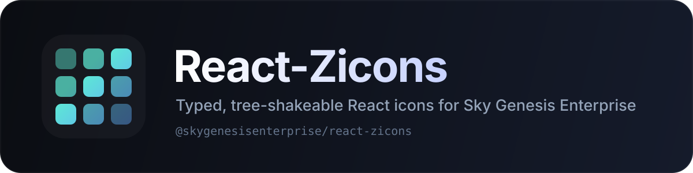

# React-Zicons

[](LICENSE)
[](https://www.npmjs.com/package/@skygenesisenterprise/react-zicons)
[](https://nodejs.org)
[](https://pnpm.io)
[](https://typescriptlang.org)
[](https://react.dev)
[](CONTRIBUTING.md)

<div align="center">
  <a href="https://github.com/skygenesisenterprise/react-zicons">
    
  </a>
  <br />
  <br />
</div>

> A typed, tree-shakeable React icon system, built to last.

**React-Zicons** is the official React icon library for the [Sky Genesis Enterprise](https://skygenesisenterprise.com) ecosystem. It ships a centralized, validated icon catalog, a shared rendering engine, generated components for every icon, server-rendering entry points, and a reproducible asset pipeline. The initial icon family is [Phosphor Icons](https://phosphoricons.com), pinned to a reviewed upstream revision and distributed under its original MIT license.

**Perfect for:** product teams building SGE applications, design-system maintainers, Next.js and React Server Component projects, and library authors who need stable icon imports without runtime file access or remote SVG requests.

## Contents

- [React-Zicons](#react-zicons)
  - [Contents](#contents)
  - [Why React-Zicons matters](#why-react-zicons-matters)
  - [What you get](#what-you-get)
    - [A real catalog](#a-real-catalog)
    - [A small rendering runtime](#a-small-rendering-runtime)
    - [Server and client entry points](#server-and-client-entry-points)
    - [A reproducible asset pipeline](#a-reproducible-asset-pipeline)
    - [Distribution built for tree-shaking](#distribution-built-for-tree-shaking)
  - [Quick start](#quick-start)
    - [Install](#install)
    - [Render icons](#render-icons)
    - [Use a provider](#use-a-provider)
    - [Import one icon directly](#import-one-icon-directly)
    - [Render on the server](#render-on-the-server)
    - [Query the catalog](#query-the-catalog)
  - [Supported weights](#supported-weights)
  - [How React-Zicons is built](#how-react-zicons-is-built)
    - [Repository layout](#repository-layout)
    - [Core modules](#core-modules)
    - [Generated components](#generated-components)
    - [Generation pipeline](#generation-pipeline)
    - [Source abstraction](#source-abstraction)
  - [API overview](#api-overview)
    - [Icon props](#icon-props)
    - [Provider](#provider)
    - [Package entry points](#package-entry-points)
  - [Framework compatibility](#framework-compatibility)
  - [Development](#development)
    - [Requirements](#requirements)
    - [Root commands](#root-commands)
    - [Asset synchronization](#asset-synchronization)
    - [Testing](#testing)
  - [FAQ](#faq)
    - [Is React-Zicons a fork of Phosphor React?](#is-react-zicons-a-fork-of-phosphor-react)
    - [Does it include every Phosphor icon?](#does-it-include-every-phosphor-icon)
    - [Can I import only one icon?](#can-i-import-only-one-icon)
    - [Does it work in React Server Components?](#does-it-work-in-react-server-components)
    - [Can I add another icon family?](#can-i-add-another-icon-family)
    - [Where is the documentation?](#where-is-the-documentation)
  - [Related resources](#related-resources)
    - [Official](#official)
    - [Upstream](#upstream)
  - [Contributing](#contributing)
  - [Security](#security)
  - [License](#license)
  - [Note](#note)

## Why React-Zicons matters

🎯 **One icon catalog, one source of truth** — Names, aliases, categories, tags, weights, codepoints, publication versions, source revisions, and licensing live in a typed catalog generated from reviewed upstream metadata.

🧩 **A shared engine, not copied components** — Every icon renders through the same `IconBase` and `SSRBase` implementations. Generated files contain data only; rendering behavior is maintained in one place.

⚡ **Tree-shaking first** — The package is ESM-only with `sideEffects: false`, explicit exports, individual icon subpaths, and no runtime catalog loading on the icon path. Importing one icon does not pull the whole set.

🖥️ **Server-ready by design** — Client icons support context and refs. `@skygenesisenterprise/react-zicons/ssr` provides context-free icons that render in React Server Components without a client boundary.

🔄 **Reproducible, reviewable assets** — Upstream assets are vendored at a recorded commit. Synchronization is an explicit command. Generation is deterministic: the same upstream revision produces byte-identical output.

🔒 **Licensing is explicit** — Original SGE code is MIT. Upstream Phosphor assets and metadata remain MIT with their copyright notice preserved in [`NOTICE`](NOTICE) and [`vendor/phosphor/LICENSE`](vendor/phosphor/LICENSE).

## What you get

### A real catalog

The catalog is generated, validated, and strongly typed. Each entry describes:

- a stable cross-source identifier, canonical name, PascalCase name, and kebab-case identifier;
- aliases and their PascalCase forms;
- categories, search tags, and available weights;
- source identity, version, commit, viewBox, codepoint, publication and update versions;
- license and copyright attribution.

Asset validation fails the build when SVGs are missing, malformed, unsupported, duplicated, or inconsistent. Missing weights are never silently substituted.

### A small rendering runtime

- `IconBase` for context-aware client icons with `React.forwardRef`.
- `SSRBase` for context-free server icons.
- `ZIconProvider` for optional, nestable defaults.
- SVG native props, custom children, accessible titles, mirrored rendering, and `currentColor` support.
- A default size of `1em` so icons scale with surrounding text.

### Server and client entry points

- `@skygenesisenterprise/react-zicons` — client icons, provider, core types.
- `@skygenesisenterprise/react-zicons/ssr` — server icons and server-safe utilities.
- `@skygenesisenterprise/react-zicons/icons/*` — individual client icons.
- `@skygenesisenterprise/react-zicons/ssr/icons/*` — individual server icons.
- `@skygenesisenterprise/react-zicons/catalog` — catalog data and lookup helpers.
- `@skygenesisenterprise/react-zicons/provider` — provider-only entry point.

### A reproducible asset pipeline

The pipeline is explicit and reviewable:

```text
Pinned upstream revision
          │
          ▼
   pnpm assets:sync
          │
          ▼
   pnpm assets:validate
          │
          ▼
      pnpm generate
          │
          ├── typed catalog
          ├── client components
          ├── server components
          ├── alias modules
          ├── entry points
          └── name types
          │
          ▼
       pnpm test
          │
          ▼
       pnpm build
```

### Distribution built for tree-shaking

- ESM-only output with TypeScript declarations.
- React is a peer dependency and is never bundled.
- No remote SVG requests, no runtime file-system access, and no runtime catalog import in icon modules.
- Package export maps for root, SSR, catalog, provider, core, and individual icons.
- Bundle-size and tree-shaking checks are part of the test tooling.

## Quick start

### Install

```bash
pnpm add @skygenesisenterprise/react-zicons
```

React `18.2` or later is required. React is a peer dependency.

### Render icons

```tsx
import { HeartIcon, HouseIcon } from "@skygenesisenterprise/react-zicons";

export function Toolbar() {
  return (
    <nav>
      <HouseIcon />
      <HeartIcon weight="fill" size={32} color="#e11d48" alt="Favourite" />
    </nav>
  );
}
```

### Use a provider

The provider is optional. Explicit icon props win over the nearest provider, which wins over library defaults.

```tsx
import { HeartIcon, ZIconProvider } from "@skygenesisenterprise/react-zicons";

export function App() {
  return (
    <ZIconProvider value={{ size: 24, weight: "regular", color: "currentColor" }}>
      <HeartIcon />
      <HeartIcon weight="bold" /> {/* explicit prop wins */}
    </ZIconProvider>
  );
}
```

Nested providers inherit unspecified keys from their parent and override only the keys present in their `value`.

### Import one icon directly

Use a direct subpath when you want the smallest possible module graph or when your bundler benefits from explicit imports:

```tsx
import HeartIcon from "@skygenesisenterprise/react-zicons/icons/Heart";

export function LikeButton() {
  return <HeartIcon weight="duotone" size="1.25em" />;
}
```

Named imports are available from the same module:

```tsx
import { HeartIcon } from "@skygenesisenterprise/react-zicons/icons/Heart";
```

### Render on the server

Use the SSR entry point in server components, static rendering, or any environment where React context is unavailable:

```tsx
import { HeartIcon, HouseIcon } from "@skygenesisenterprise/react-zicons/ssr";

export function ServerToolbar() {
  return (
    <div>
      <HouseIcon weight="bold" />
      <HeartIcon weight="fill" alt="Favourite" />
    </div>
  );
}
```

Individual server icons are available at `@skygenesisenterprise/react-zicons/ssr/icons/Heart`.

SSR icons do not read provider context and do not forward refs. Use the default entry point when you need context or a forwarded ref.

### Query the catalog

```ts
import { findIcon, searchIcons } from "@skygenesisenterprise/react-zicons/catalog";

const heart = findIcon("heart");
const results = searchIcons("favourite");
```

The catalog entry is separate from the icon runtime, so importing it does not pull React components or SVG path data.

## Supported weights

The bundled Phosphor source provides six weights. Every generated icon exposes all six.

| Weight | Description | Typical use |
| --- | --- | --- |
| `thin` | Thinnest strokes | Dense interfaces, large decorative icons |
| `light` | Lighter strokes | Secondary actions, quiet layouts |
| `regular` | Default balanced weight | General interface use |
| `bold` | Heavier strokes | Emphasis, primary actions |
| `fill` | Solid filled shapes | Selected states, compact navigation |
| `duotone` | Two-tone filled shape plus outline | Decorative and brand-forward surfaces |

```tsx
<HeartIcon weight="thin" />
<HeartIcon weight="light" />
<HeartIcon weight="regular" />
<HeartIcon weight="bold" />
<HeartIcon weight="fill" />
<HeartIcon weight="duotone" />
```

## How React-Zicons is built

React-Zicons is a single, focused pnpm package. It is not a monorepo, and it does not depend on upstream React component source.

### Repository layout

```text
react-zicons/
├── src/
│   ├── core/                 # IconBase, SSRBase, context, provider, types, utils
│   ├── icons/generated/      # Generated client icons, aliases and barrel
│   ├── ssr/generated/        # Generated server icons, aliases and barrel
│   ├── ssr/index.ts          # Server entry point
│   ├── catalog/              # Catalog types, generated catalog, lookup helpers
│   ├── provider/index.ts     # Provider-only entry point
│   └── index.ts              # Generated client entry point
├── scripts/
│   ├── sync-assets.ts        # Explicit upstream synchronization
│   ├── validate-assets.ts    # Asset and metadata validation
│   ├── generate-catalog.ts   # Typed catalog generation
│   ├── generate-icons.ts     # Client, SSR and alias component generation
│   ├── generate-exports.ts   # Entry point generation
│   ├── generate-types.ts     # Icon name union generation
│   ├── generate.ts           # Full generation workflow
│   ├── build.ts              # TypeScript build and output verification
│   ├── measure-bundle.ts     # Bundle-size and tree-shaking checks
│   ├── test-consumer.ts      # Packaged-consumer checks
│   ├── test-next.ts          # Next.js consumer build check
│   └── lib/                  # Shared pipeline utilities
├── vendor/phosphor/          # Pinned Phosphor assets, metadata and license
├── tests/                    # Unit, asset, integration and regression tests
├── docs/                     # Documentation source
└── .github/                  # CI, release, issue and PR infrastructure
```

### Core modules

| Module | Role |
| --- | --- |
| `src/core/IconBase.tsx` | Client renderer: context, refs, weights, children, accessibility |
| `src/core/SSRBase.tsx` | Server renderer: no context, no refs, RSC-compatible |
| `src/core/provider.tsx` | `ZIconProvider` and nested-provider merging |
| `src/core/context.ts` | Internal icon context |
| `src/core/types.ts` | Public `IconProps`, `IconWeight`, `IconWeights` and related types |
| `src/core/utils.ts` | Precedence resolution, path rendering, mirrored styles |
| `src/catalog/index.ts` | Catalog exports, `findIcon` and `searchIcons` |

### Generated components

Generated client icon modules contain only weight data and a thin component wrapper:

```tsx
"use client";

import * as React from "react";
import { IconBase } from "../../core/IconBase.js";
import type { Icon, IconWeights } from "../../core/types.js";

const weights: IconWeights = {
  viewBox: "0 0 256 256",
  paths: {
    /* six weights */
  },
};

export const HeartIcon: Icon = React.forwardRef(function HeartIcon(props, ref) {
  return <IconBase ref={ref} {...props} weights={weights} />;
});
```

Generated SSR icons use the same weight data but render through `SSRBase`. Alias modules re-export canonical components, so aliases share the same implementation and types.

Generated files carry an explicit header. Do not edit them by hand; change the generator or the upstream source instead.

### Generation pipeline

Each script has one responsibility:

| Command | Responsibility |
| --- | --- |
| `pnpm assets:sync` | Fetch a pinned upstream revision and copy assets, metadata and license |
| `pnpm assets:validate` | Validate SVGs, weights, viewBoxes, naming and catalog metadata |
| `pnpm generate:catalog` | Generate the typed catalog |
| `pnpm generate:icons` | Generate client icons, SSR icons and alias modules |
| `pnpm generate:exports` | Generate root, SSR, icon and catalog entry points |
| `pnpm generate:types` | Generate `IconName` and `IconComponentName` unions |
| `pnpm generate` | Run the complete generation sequence |

Generation is deterministic and does not contact the network. Synchronization is the only step that reaches upstream, and it is always explicit.

### Source abstraction

The pipeline separates general pipeline types from Phosphor-specific reading and transformation rules. The catalog describes a source with an identity, repository, version, commit, license, copyright, and website. Icon definitions carry source-specific categories, tags, codepoints, and publication versions while exposing a stable public shape.

Today, only Phosphor is implemented. A future SGE-owned icon family can add a new loader and generator adapter without changing `IconBase`, `SSRBase`, the provider, or the public React API.

## API overview

### Icon props

`IconProps` extends the native SVG props with the following additions:

| Prop | Type | Default | Description |
| --- | --- | --- | --- |
| `size` | `number \| string` | `"1em"` | Width and height |
| `color` | `string` | `"currentColor"` | SVG fill color |
| `weight` | `IconWeight` | `"regular"` | One of the six supported weights |
| `mirrored` | `boolean` | `false` | Horizontally mirrors the rendered icon |
| `alt` | `string` | — | Accessible title rendered as `<title>` |
| `children` | `ReactNode` | — | Custom SVG children rendered before the weight paths |

All other supported SVG attributes are forwarded. Client icons forward refs to the underlying `<svg>` element. Native props passed explicitly, such as `width`, `height`, `fill`, `viewBox`, `role`, or `aria-*`, take precedence over library defaults.

Icons without `alt` are rendered with `aria-hidden="true"` and `focusable="false"`. Icons with `alt` receive `role="img"` and a `<title>`.

### Provider

```tsx
import { ZIconProvider } from "@skygenesisenterprise/react-zicons";

<ZIconProvider value={{ size: 24, weight: "regular", color: "currentColor" }}>
  {children}
</ZIconProvider>
```

`ZIconProvider` accepts `color`, `size`, `weight`, and `mirrored`. Property precedence:

1. Explicit icon properties.
2. Nearest provider configuration.
3. Parent provider configuration for keys the nearest provider does not set.
4. Library defaults.

The provider is optional and client-only.

### Package entry points

| Import | Contents |
| --- | --- |
| `@skygenesisenterprise/react-zicons` | All client icons, `IconBase`, `ZIconProvider`, core types |
| `@skygenesisenterprise/react-zicons/icons` | All client icons |
| `@skygenesisenterprise/react-zicons/icons/Heart` | One client icon (default and named exports) |
| `@skygenesisenterprise/react-zicons/ssr` | All server icons, `SSRBase`, server-safe utilities |
| `@skygenesisenterprise/react-zicons/ssr/icons` | All server icons |
| `@skygenesisenterprise/react-zicons/ssr/icons/Heart` | One server icon |
| `@skygenesisenterprise/react-zicons/catalog` | Catalog data, `findIcon`, `searchIcons`, catalog types |
| `@skygenesisenterprise/react-zicons/provider` | `ZIconProvider` and context types |
| `@skygenesisenterprise/react-zicons/core` | Core renderer, provider, types and utilities |

The package is ESM-only. It does not ship a CommonJS build. This keeps the package modern, avoids duplicated module graphs, and matches the supported React and Next.js toolchains.

## Framework compatibility

| Environment | Support | Notes |
| --- | --- | --- |
| React 18.2 | Yes | Client icons, provider, refs |
| React 19 | Yes | Client and server entries |
| Next.js App Router | Yes | Use `/ssr` in Server Components; use the root entry in Client Components |
| React Server Components | Yes | Use `/ssr`; server icons do not depend on context or refs |
| Vite | Yes | ESM and export maps |
| Webpack 5 | Yes | ESM and export maps |
| Rollup | Yes | ESM, named exports, `sideEffects: false` |
| Node.js ESM | Yes | `>=20.19` |
| CommonJS `require()` | No | ESM-only package |

For Next.js package-import performance, add the package to `experimental.optimizePackageImports` if your version supports it, or use direct subpath imports.

## Development

### Requirements

- Node.js `20.19` or later.
- pnpm `12.18` or later, as pinned by `packageManager`.

### Root commands

```bash
pnpm install          # install from the lockfile
pnpm assets:sync      # explicitly sync the pinned upstream revision
pnpm assets:validate  # validate assets, metadata and catalog integrity
pnpm generate         # regenerate catalog, icons, exports and types
pnpm build            # type-check and emit dist/
pnpm test             # run the Vitest suite
pnpm test:bundle      # measure bundle size and verify tree-shaking
pnpm test:consumer    # verify the packaged consumer surface
pnpm test:next        # build a real Next.js consumer fixture
pnpm typecheck        # type-check source, scripts and tests
pnpm lint             # run ESLint
pnpm format:check     # check formatting with Prettier
pnpm clean            # remove build, coverage and fixture output
```

### Asset synchronization

Upstream assets are vendored under `vendor/phosphor` and pinned in `vendor/phosphor/upstream.json`:

```json
{
  "repository": "https://github.com/phosphor-icons/core",
  "version": "2.1.1",
  "commit": "2b75f3ad12b420c9504ef05df8d2564a28f8500e"
}
```

To update, run synchronization explicitly and review the diff:

```bash
pnpm assets:sync
pnpm assets:validate
pnpm generate
git diff --stat
```

To sync a different revision intentionally:

```bash
pnpm assets:sync --ref <commit-or-branch>
```

Production builds never update upstream automatically. The recorded commit is the source of truth for reproducible generation.

### Testing

The test suite covers:

- `IconBase`, `SSRBase`, `ZIconProvider`, context inheritance and precedence.
- Default properties, weight selection, mirrored icons, SVG children, refs and accessibility.
- Alias resolution and catalog integrity.
- SVG validity, asset completeness, weight consistency, naming, duplicates and metadata.
- React rendering, server-side rendering, ESM imports, TypeScript imports and individual icon imports.
- Public API regression snapshots.
- Real consumer bundling and a Next.js App Router build.

CI runs linting, type checking, asset validation, generation determinism, tests, bundle checks and a production build. Releases are published through GitHub Actions with provenance and least-privilege permissions.

## FAQ

### Is React-Zicons a fork of Phosphor React?

No. React-Zicons is an independent implementation. The architecture was informed by Phosphor Icons Core and Phosphor React, but the rendering engine, catalog schema, generator, validation, packaging and public API are maintained by Sky Genesis Enterprise. No upstream React component source is copied verbatim.

### Does it include every Phosphor icon?

Yes. The initial vendor snapshot is Phosphor Icons Core `2.1.1` at commit `2b75f3ad12b420c9504ef05df8d2564a28f8500e`, containing 1,512 icons, six weights, and 9,072 SVG files.

### Can I import only one icon?

Yes. Use a subpath import such as `@skygenesisenterprise/react-zicons/icons/Heart`, or import named icons from the root. The package is ESM-first with `sideEffects: false`, so modern bundlers can tree-shake unused icons.

### Does it work in React Server Components?

Yes, through the `/ssr` entry point. Server icons render without React context or refs. The root entry is the client entry point and includes context support.

### Can I add another icon family?

The architecture is designed for it, but no plugin system is implemented today. A new family adds its own pinned assets, source adapter and generation rules while reusing the shared catalog schema and rendering engine. This keeps source-specific transformations isolated without over-engineering the current release.

### Where is the documentation?

Documentation lives in [`docs/`](docs). The README covers installation, usage and development; the `docs/` tree covers architecture, providers, rendering, framework guides, API reference, asset synchronization, generation, testing, releases and licensing.

## Related resources

### Official

- Repository: [github.com/skygenesisenterprise/react-zicons](https://github.com/skygenesisenterprise/react-zicons)
- npm package: [@skygenesisenterprise/react-zicons](https://www.npmjs.com/package/@skygenesisenterprise/react-zicons)
- Sky Genesis Enterprise: [skygenesisenterprise.com](https://skygenesisenterprise.com)
- Documentation source: [`docs/`](docs)
- Contributing guide: [`CONTRIBUTING.md`](CONTRIBUTING.md)
- Support: [`SUPPORT.md`](SUPPORT.md)

### Upstream

- Phosphor Icons: [phosphoricons.com](https://phosphoricons.com)
- Phosphor Core: [github.com/phosphor-icons/core](https://github.com/phosphor-icons/core)
- Phosphor React: [github.com/phosphor-icons/react](https://github.com/phosphor-icons/react)
- Upstream license: [`vendor/phosphor/LICENSE`](vendor/phosphor/LICENSE)

## Contributing

Contributions and suggestions are welcome. Read the [Code of Conduct](CODE_OF_CONDUCT.md) before participating, then follow the [contribution guide](CONTRIBUTING.md).

- Use the pull request template that matches your change.
- Keep PR titles in [Conventional Commits](https://www.conventionalcommits.org) format (`fix: …`, `feat: …`, `docs: …`).
- Add a changeset with `pnpm changeset` for user-facing changes.
- Run `pnpm assets:validate`, `pnpm generate`, `pnpm test`, `pnpm typecheck` and `pnpm lint` before opening a pull request.
- Never hand-edit files under `src/icons/generated`, `src/ssr/generated`, `src/catalog/catalog.generated.ts`, or generated entry points.

## Security

Do not report security vulnerabilities in public issues. Follow the private reporting instructions in [SECURITY.md](SECURITY.md).

## License

The React-Zicons implementation is licensed under the [MIT License](LICENSE).

The bundled Phosphor icon assets and metadata are derived from Phosphor Icons Core, are licensed under the MIT License, and remain copyright © 2023 Phosphor Icons. The original license text is preserved in [`vendor/phosphor/LICENSE`](vendor/phosphor/LICENSE). See [`NOTICE`](NOTICE) for the complete attribution statement.

React is a peer dependency and is not bundled with this package.

## Note

React-Zicons is maintained by [Sky Genesis Enterprise](https://skygenesisenterprise.com). Phosphor Icons is an independent project; references to it describe the upstream asset source and do not imply ownership or endorsement. Links to external services are provided for convenience and do not imply endorsement. Check each service's own terms before relying on it in production.
